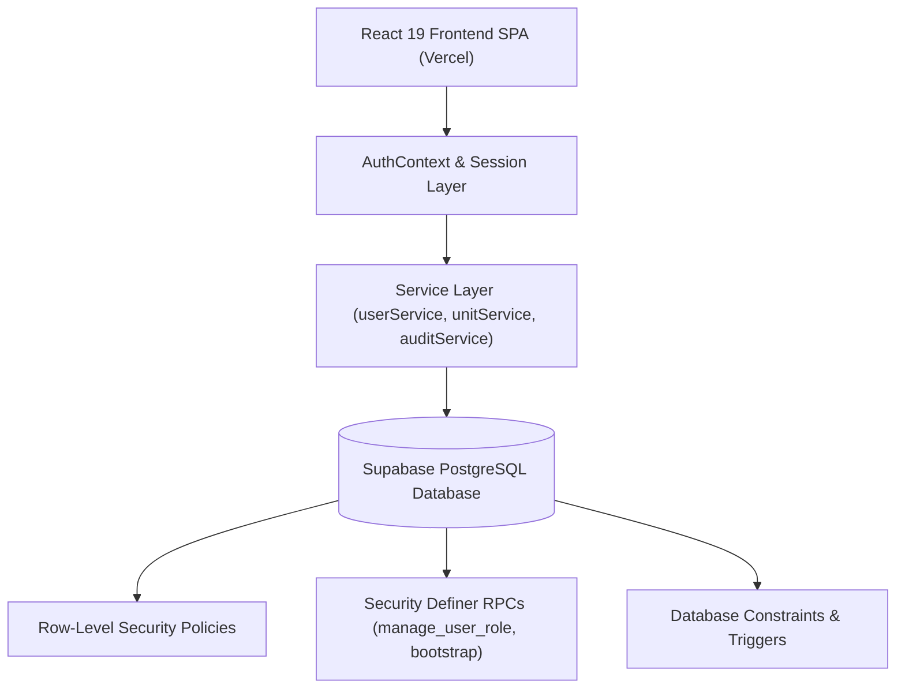

# Architecture Document — YSA AMS

## 1. Overview
The Abeokuta Nigeria Obantoko Stake YSA Attendance Management System is architected as a modern, decoupled Single-Page Application (SPA) communicating directly with a Supabase PostgreSQL backend.

Privileged security operations, role validation, account deactivations, and scoping logic are enforced at the PostgreSQL database engine level using Row-Level Security (RLS), database triggers, and `SECURITY DEFINER` Remote Procedure Calls (RPC).

---

## 2. Component Interaction & Separation of Concerns

### A. Presentation Layer (`src/components/`)
- Pure presentation and user interaction.
- Does **not** determine authorization status.
- Displays navigation items conditionally based on fetched database roles, but relies exclusively on the database returning authorized records or rejecting forbidden actions.

### B. Session & Identity Layer (`src/context/AuthContext.tsx`)
- Coordinates Supabase Auth session tokens.
- Upon session detection, performs an immediate lookup of `user_profiles`, `user_roles`, and `user_unit_assignments`.
- Deactivated accounts are flagged immediately and barred from the authenticated application shell.

### C. Typed Service Layer (`src/services/`)
- Encapsulates database queries and RPC invocations.
- `userService.ts`: Handles user queries, role assignment RPCs, status update RPCs, and bootstrap.
- `unitService.ts`: Handles ward/branch lookups and unit assignment modifications.
- `auditService.ts`: Handles read-only fetching of append-only audit events.

### D. PostgreSQL Engine & Security Enforcers (`supabase/migrations/`)
- All business authorization rules (e.g. Bishop only assigned to a Ward, Branch President only to a Branch, last administrator cannot be revoked) reside in SQL triggers and RPC functions with safe `search_path = public, pg_temp`.
- Append-only audit logging is strictly enforced via `fn_prevent_audit_log_modification()` trigger preventing any UPDATE or DELETE operations.
